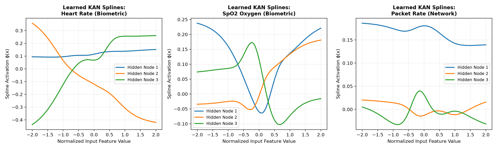
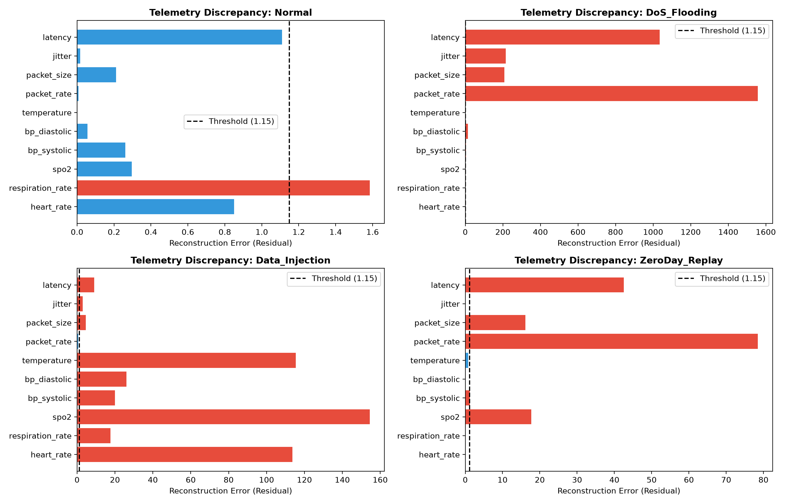

# AURA-IoMT: Explainable KAN Digital Twin for Zero-Day Cyber-Physical IDS

**AURA-IoMT** is an intrinsically explainable **Behavioral Digital Twin** and **Intrusion Detection System (IDS)** for Internet of Medical Things (IoMT) environments. Built with a custom **Kolmogorov-Arnold Network (KAN)** autoencoder implemented from scratch in PyTorch, it fuses physiological vitals and network flow telemetry to detect unseen zero-day cyber-physical attacks in real time (`< 2 ms` CPU inference) with native spline and root-cause explainability.

---

## Key Highlights

- **Custom PyTorch KAN Layer (`KANLinear`)**: Replaces fixed MLP node activations (ReLU) with learnable 1D cubic B-spline functions parameterized on edges via the Cox-de Boor recurrence relation and a SiLU residual backbone.
- **Zero-Day Resilient Digital Twin**: Trained strictly semi-supervised on benign baseline telemetry (`10 → 6 → 3 → 6 → 10` hourglass autoencoder)—zero attack signatures or labels are seen during training.
- **Cyber-Physical Sensor Fusion**: Simultaneously models **6 biometric vitals** and **4 network flow metrics**, catching network floods (`DoS`), spoofed patient telemetry (`FDIA`), and cross-layer `Zero-Day` exploits.
- **Statistically Calibrated Decision Boundary**: Anomaly cutoff calibrated at the **98th percentile** of benign training reconstruction error (`Threshold = 1.1492`), bounding false alarms near `~2%` with zero attack data leakage.
- **Dual-Level Intrinsic Explainability (XAI)**:
  - **Global Edge Inspection**: Plots actual learned univariate B-spline curves directly from encoder edges (no slow post-hoc SHAP/LIME approximations).
  - **Local Root-Cause Attribution**: Computes per-feature squared residuals `(xᵢ - x̂ᵢ)²` on every alert to pinpoint whether an intrusion originated in network traffic or patient biometrics.
- **Full-Stack Clinical SOC Dashboard**: FastAPI inference server paired with a high-contrast, light-theme, zero-radius real-time monitoring UI featuring live telemetry streaming and interactive threat injection.

---

## System Architecture

```text
Incoming Telemetry (10 Cyber-Physical Features)
       │
       ▼
StandardScaler (fit strictly on benign training baseline)
       │
       ▼
┌────────────────────────────────────────────────────────┐
│           KAN Behavioral Digital Twin (AE)             │
│   10 ──[KAN]──▶ 6 ──[KAN]──▶ 3 ──[KAN]──▶ 6 ──[KAN]──▶ 10   │
│         Encoder           Latent          Decoder      │
└────────────────────────────────────────────────────────┘
       │                                        │
       ▼                                        ▼
Total MSE Error: (1/10) Σ(xᵢ - x̂ᵢ)²     Per-Feature Residuals
  • ≤ 1.1492 → Twin Synchronized         Pinpoints exact root-cause
  • > 1.1492 → Anomaly Breach            vitals or network metrics
```

---

## Dataset & Monitored Features

The benchmark generator (`src/dataset_generator.py`) synthesizes **25,000** cyber-physical telemetry samples calibrated on published **WUSTL-EHMS-2020** medical testbed distributions, with realistic cardiovascular coupling (`bp_systolic = 0.8 * heart_rate + N(65, 5)`).

### Feature Space (10 Dimensions)
| Domain | Features |
| :--- | :--- |
| **Biometric Vitals (6)** | `heart_rate`, `respiration_rate`, `spo2`, `bp_systolic`, `bp_diastolic`, `temperature` |
| **Network Flow (4)** | `packet_rate`, `packet_size`, `jitter`, `latency` |

### Threat Scenarios & Zero-Day Split
| Scenario | Domain | Total Samples | Training Set | Test Set |
| :--- | :--- | :---: | :---: | :---: |
| **Normal Baseline** | Benign Cyber-Physical | 17,500 | 14,000 (80%) | 3,500 (20%) |
| **DoS Flooding** | Cyber Anomaly | 2,500 | 0 *(Held out)* | 2,500 (100%) |
| **Data Injection (FDIA)** | Physical Anomaly | 2,500 | 0 *(Held out)* | 2,500 (100%) |
| **Zero-Day Replay** | Cross-Layer Novel Exploit | 2,500 | 0 *(Held out)* | 2,500 (100%) |

---

## Experimental Results

> **Note on Experimental Scope:** This project is built primarily as a proof-of-concept to demonstrate novel architectural ideas—combining cyber-physical behavioral digital twins, semi-supervised KAN spline modeling, and intrinsic root-cause explainability. Because the evaluation runs at a modest scale (`25,000` calibrated samples across `3` distinct attack profiles), the near-perfect scores below (`100%` recall, `1.0000` ROC-AUC) reflect a controlled benchmark setting rather than production hospital complexity. Real-world deployments involve noisier clinical hardware, overlapping patient edge cases, and subtler adversarial behavior, so these results should be viewed as an illustrative demonstration of the pipeline rather than real-world performance guarantees.

Evaluated on **11,000 unseen test samples** (`3,500` Normal + `7,500` across all 3 attack classes):

| Metric | Score |
| :--- | :--- |
| **Overall Accuracy** | **99.25%** |
| **Attack Precision** | **0.9892** |
| **Attack Recall** | **1.0000** *(100% caught)* |
| **Attack F1-Score** | **0.9946** |
| **ROC-AUC** | **1.0000** |
| **False Alarm Rate** | **2.34%** |

### Per-Scenario Breakdown
| Traffic Class | Detection / Accuracy | Average Reconstruction Error (MSE) |
| :--- | :---: | :---: |
| **Normal Baseline** | 97.66% Accuracy | `0.3985` |
| **DoS Flooding** | 100.00% Recall | `227.8697` |
| **Data Injection (FDIA)** | 100.00% Recall | `38.2373` |
| **Zero-Day Replay** | 100.00% Recall | `25.9698` *(22× threshold)* |

---

## Explainable AI (XAI) Visualizations

### Learned B-Spline Edge Activations
Each subplot shows learned 1D activation curves `ϕ(x)` from the first KAN encoder layer (`enc1`) across the first three hidden nodes, capturing physiological patterns directly in network edges (such as autonomous U-shaped `SpO2` regulation).



### Root-Cause Discrepancy Attribution Matrix
Per-feature squared reconstruction errors cleanly separate cyber floods (`packet_rate`, `latency`), physical tampering (`spo2`, `bp_systolic`), and multi-layer zero-day desynchronization.



---

## Project Structure

```text
├── backend/
│   └── main.py                 # FastAPI server: model loading, inference, XAI & live stream endpoints
├── data/
│   └── iomt_telemetry.csv      # 25,000-row cyber-physical telemetry benchmark
├── frontend/
│   ├── index.html              # Clinical SOC monitoring dashboard
│   ├── style.css               # Sharp-edged light architectural CSS styling
│   ├── app.js                  # Real-time polling, threat injection & discrepancy bars
│   └── static/
│       ├── kan_splines.png     # Extracted B-spline activation plots
│       └── feature_attribution.png
├── models/
│   ├── kan_digital_twin.pth    # Trained KAN autoencoder checkpoint & calibrated threshold
│   └── scaler.pkl              # StandardScaler fit strictly on benign training data
└── src/
    ├── dataset_generator.py    # Cyber-physical dataset synthesizer
    ├── kan.py                  # Custom PyTorch KANLinear layer (Cox-de Boor B-splines)
    ├── train.py                # Semi-supervised training, calibration & zero-day evaluation
    └── explain.py              # Intrinsic XAI & visualization generator
```

---

## Quick Start

### 1. Environment Setup
```bash
python -m venv .venv

# Windows (PowerShell)
.\.venv\Scripts\Activate.ps1

# Linux / macOS
source .venv/bin/activate

pip install torch numpy pandas scikit-learn matplotlib fastapi uvicorn
```

### 2. Reproduce Dataset, Training & XAI Plots *(Optional — pre-trained artifacts included)*
```bash
python src/dataset_generator.py
python src/train.py
python src/explain.py
```

### 3. Launch the Real-Time Dashboard & API
```bash
python -m uvicorn backend.main:app --reload --port 8000
```

- **Clinical SOC Dashboard:** `http://localhost:8000`
- **Interactive API Docs (Swagger UI):** `http://localhost:8000/docs`

---

## API Endpoints

| Method | Endpoint | Description |
| :--- | :--- | :--- |
| `GET` | `/api/status` | Returns model architecture metadata, status, and calibrated threshold |
| `POST` | `/api/predict` | Scores a 10-feature telemetry payload and flags digital twin desynchronization |
| `POST` | `/api/explain` | Returns sorted per-feature reconstruction residuals for root-cause diagnosis |
| `GET` | `/api/telemetry/sample` | Streams sample telemetry (`Normal`, `DoS_Flooding`, `Data_Injection`, `ZeroDay_Replay`) |

---

## References

- Liu, Z., et al. (2024). *KAN: Kolmogorov-Arnold Networks*. arXiv:2404.19756.
- Shen, X., Jain, R., et al. (2020). *WUSTL-EHMS-2020: An Enhanced Healthcare Monitoring System Dataset for Cyber-Physical Medical Device Security*.
